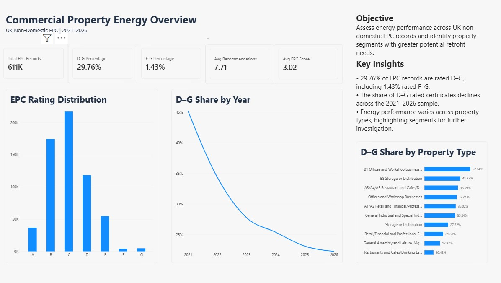
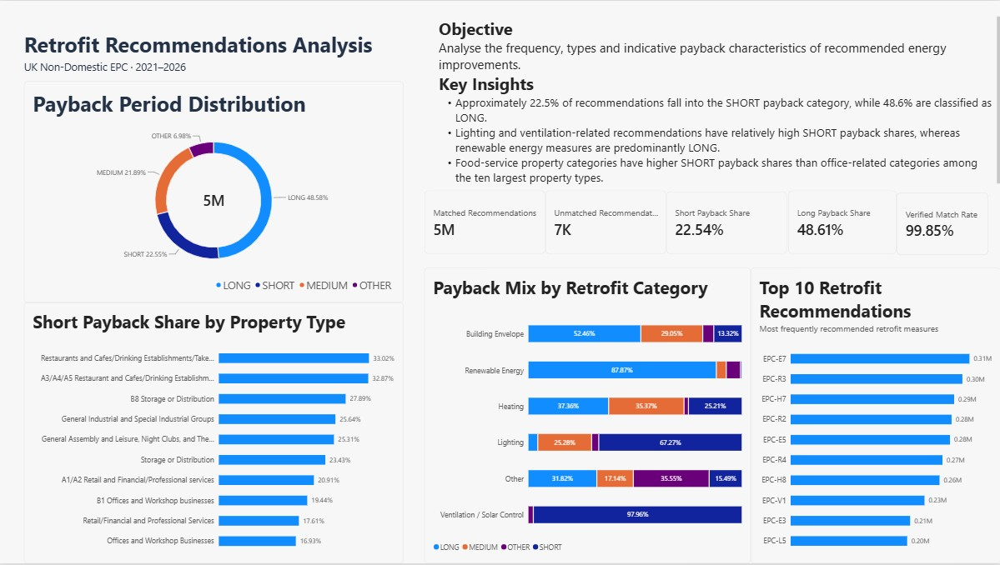
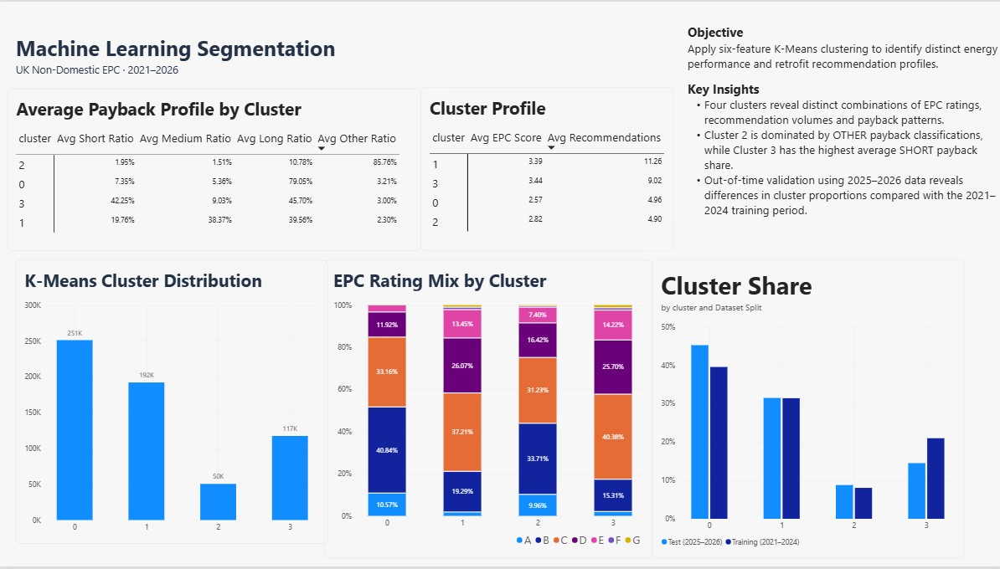
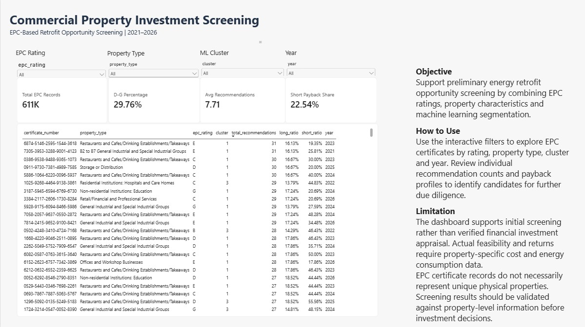

# UK Commercial Property EPC Analytics

**PostgreSQL · SQL · Python · K-Means · Power BI**

An end-to-end data analytics portfolio project exploring energy performance and indicative retrofit opportunities in **UK non-domestic Energy Performance Certificate (EPC)** records from **2021–2026**. The workflow combines relational data engineering, unsupervised machine learning, temporal validation, and an interactive Power BI screening dashboard.

> **Purpose:** Identify property segments and certificate records worth **further retrofit due diligence**. This is not an asset valuation, a verified investment-return model, or a ranking of unique buildings.

## Dashboard preview

### 1. Commercial Property Energy Overview


EPC rating distribution, lower-rated (D–G and F–G) shares, trends by certificate lodgement year, and comparisons across property types.

### 2. Retrofit Recommendations Analysis


Recommendation payback categories, top recommendation codes, retrofit categories, and SHORT-payback shares across major property types.

### 3. Machine Learning Segmentation


K-Means cluster sizes, EPC rating mix, certificate-level payback profiles, and train-versus-test comparisons.

### 4. Commercial Property Investment Screening


Interactive filters for EPC grade, property type, cluster, and year, with a certificate-level list for additional investigation.

*The images above will render after the four JPG files are uploaded to the `images/` directory using these exact filenames.*

## Project at a glance

| Metric | Result |
| --- | ---: |
| EPC certificates with valid A–G ratings in the modelling/reporting sample | **610,950** |
| Recommendation records in the linked source dataset | **Approximately 4.72 million** |
| Recommendation-to-certificate match rate for the reporting sample | **99.85%** |
| Share of sample certificates rated D–G | **29.76%** |
| Share rated F–G | **1.43%** |
| Average recommendations per sample certificate | **7.71** |
| K-Means segments | **4** |
| Training period / certificates | **2021–2024 / 443,953** |
| Out-of-time test period / certificates | **2025–2026 / 166,997** |

**Denominators matter.** The 610,950 records are a filtered **certificate-level** sample, not a count of distinct physical properties. Recommendation-based charts can use the full recommendations table, whereas property-type and cluster interactions use records linked to the certificate sample. The matching metric is a data-quality check, not a retrofit success rate.

## Problem and approach

The analysis addresses four questions:

1. **Energy performance:** Which rating bands and property types have a higher prevalence of lower EPC grades?
2. **Retrofit needs:** Which improvement measures recur most often, and how are their **indicative payback categories** distributed?
3. **Segmentation:** Can machine learning identify distinct combinations of energy grades, recommendation intensity and payback profiles?
4. **Decision support:** Can users narrow the dataset to certificates meriting a closer property-level assessment?

### Technical workflow

```text
UK Government EPC certificate + recommendation data (2021–2026)
              |
              v
PostgreSQL: raw -> clean -> analytics
              |
              v
SQL quality checks + certificate-level ML features
              |
              v
Python: StandardScaler + MiniBatchKMeans (K=4)
              |
              v
Out-of-time testing: train 2021–2024, test 2025–2026
              |
              v
Power BI: interactive four-page screening dashboard
```

## Tools

| Stage | Technologies | What I implemented |
| --- | --- | --- |
| Data engineering | PostgreSQL, SQL | Combined annual datasets; standardised fields; validated joins and data quality |
| Exploratory analysis | SQL | EPC rating, property type, recommendation code and payback analysis |
| Feature engineering | SQL, pandas, NumPy | One row per EPC certificate, payback counts/ratios and log-transformed recommendation volume |
| Unsupervised ML | Python, scikit-learn | StandardScaler, MiniBatchKMeans with `K=4` |
| Evaluation | Python | Train/test cluster distribution comparison, cluster profiles and centroid-distance checks |
| Reporting | Power BI, DAX | Interactive slicers, KPIs, rating/payback visualisations, certificate-level screening |

## Machine-learning methodology

The six input variables are:

| Feature | Meaning |
| --- | --- |
| `epc_rating_score` | EPC grade encoded A=1 through G=7 |
| `log_total_recommendations` | `log1p` of recommendation count |
| `short_ratio` | Share of recommendations classified SHORT |
| `medium_ratio` | Share classified MEDIUM |
| `long_ratio` | Share classified LONG |
| `other_ratio` | Share classified OTHER |

The model is fitted to **443,953 records from 2021–2024**. Scaling parameters are learned from the training set only, and **166,997 records from 2025–2026** are assigned using the fitted scaler and cluster centroids, without retraining on the test period.

The Python implementation uses `MiniBatchKMeans(n_clusters=4, random_state=42, batch_size=4096, n_init=10, max_iter=200)`.

Certificates with no recommendations have all payback ratios set to zero for modelling. The four payback ratios are compositionally related, so treating all four as standardised features changes the weight of the payback dimension. Cluster IDs are **nominal**, not a ranking of investment risk.

### Cluster profiles

These are **averages of certificate-level features** across the full six-feature dataset, not recommendation-weighted shares:

| Cluster | Avg EPC score | Avg recommendations | Characteristic |
| --- | ---: | ---: | --- |
| **0** | 2.57 | 4.96 | LONG-dominated (mean LONG ratio **79.05%**) |
| **1** | 3.39 | 11.26 | High recommendation volume; mixed MEDIUM/LONG profile |
| **2** | 2.82 | 4.90 | OTHER-dominated (mean OTHER ratio **85.76%**) |
| **3** | 3.44 | 9.02 | Highest mean SHORT ratio (**42.25%**) |

A higher EPC score means a **worse** energy grade under the A=1 to G=7 encoding.

### Out-of-time distribution check

| Cluster | Training share, 2021–2024 | Test share, 2025–2026 | Change (percentage points) |
| --- | ---: | ---: | ---: |
| 0 | 39.55% | 45.23% | +5.68 |
| 1 | 31.41% | 31.48% | +0.07 |
| 2 | 8.06% | 8.80% | +0.74 |
| 3 | 20.99% | 14.50% | -6.49 |

The test-period distribution indicates some shift, particularly for Clusters 0 and 3. This is a **temporal segmentation check**, not evidence of predictive accuracy, realised energy savings or financial returns.

## Selected findings

- **29.76%** of the analysed EPC certificate records are rated **D–G**, of which the total sample includes **1.43% F–G**.
- The D–G share is lower among certificates lodged in later sample years. This is **not** evidence that the *same properties* were upgraded.
- Across the recommendations analysed in the dashboard, approximately **22.54%** are classified SHORT and **48.61%** LONG; these are **indicative payback categories**, not verified ROI.
- Retrofit payback profiles differ by recommendation category and property type.
- The K-Means model identifies distinct combinations of EPC grade, recommendation volume and payback characteristics, useful for **exploratory screening** rather than automatic investment decisions.

## Repository structure

```text
uk-commercial-epc-analytics/
├── README.md
├── requirements.txt
├── .gitignore
├── sql/
│   └── epc.sql
├── python/
│   └── epc_kmeans.py
├── images/
│   ├── page1_overview.jpg
│   ├── page2_retrofit.jpg
│   ├── page3_clustering.jpg
│   └── page4_screening.jpg
├── data/
│   └── ml_features_with_date.csv   # local input; not necessarily committed
├── outputs/                       # generated locally
└── powerbi/
    └── epc.pbix                    # optional if distribution is appropriate
```

*This is the intended repository layout; files appear only after you upload them. The input and outputs may be excluded from Git due to size.*

## Running the Python analysis

**Requirements:** Python 3, plus packages listed in `requirements.txt`.

```bash
python -m pip install -r requirements.txt
```

1. Obtain and prepare the annual certificate and recommendation tables in PostgreSQL.
2. Produce the certificate-level dataset described by the SQL view `analytics.ml_features_with_date`.
3. Export that view as `data/ml_features_with_date.csv`, preserving its column names.
4. From the repository root, run:

```bash
python python/epc_kmeans.py
```

The script reads the CSV from `data/`, trains on 2021–2024 records, predicts clusters for 2025–2026, and writes profile tables, comparisons and labelled CSVs to `outputs/`.

**Important:** The Python script relies on the input CSV. The SQL script assumes that raw annual tables (`raw.certificates_2021` through `_2026`, and matching `raw.recommendations_*`) have already been imported into PostgreSQL. It contains setup and exploratory queries, including statements that recreate analytics tables; run in order in a **dedicated project database**, not an operational database. Import and Power BI configuration steps are not fully automated.

## Data source, licence and reproducibility

**Source:** UK Government's Energy Performance of Buildings Data service (non-domestic EPC certificates and associated recommendations).

**Official portal:** https://get-energy-performance-data.communities.gov.uk/

Before redistributing entire raw or processed datasets, check the **applicable licence and access conditions for the specific downloaded files**. This repository is intended to share analytical code, reproducibility guidance and dashboard outputs; it does not claim to redistribute a complete official database.

## Limitations

- **Certificate counts are not unique-property counts.** Multiple EPCs can refer to the same building over time.
- **Sample composition can change.** Year-to-year rating changes in cross-sectional certificate records cannot establish causal improvements in individual buildings.
- **Payback classes are indicative**, not verified costs, savings, project feasibility or realised financial returns.
- **The four clusters are unsupervised groups**, not validated risk ratings, retrofit success predictions or investment recommendations.
- **Sample-selection and join scope matter.** The A–G certificate cohort and the all-recommendations dataset do not have identical record coverage.
- Any investment decision requires property-level diligence, ownership/tenure checks, current energy use, CAPEX estimates, and applicable regulation.

---

**Portfolio skills:** SQL · PostgreSQL · Data quality · Python · Unsupervised machine learning · Temporal evaluation · Power BI · Decision support
